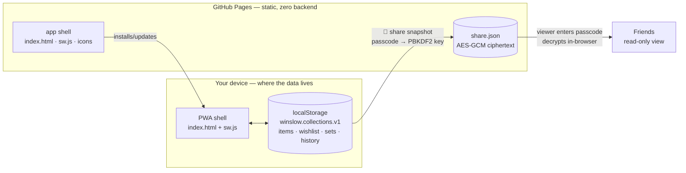
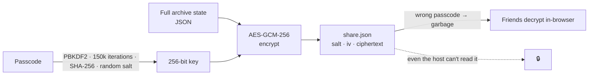
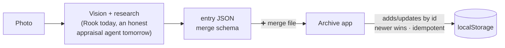

# 📦 The Collection Archive

**Live app → [wildwinslow.github.io/archive](https://wildwinslow.github.io/archive/)**

A local-first archive for logging and valuing a personal collection — coins, militaria,
games, weird objects, whatever fits in a drawer and a story. Built for one collector,
designed so the collection never becomes someone else's data.

> **The core idea:** there is no backend database. Your collection lives in *your*
> browser; the server only hosts an empty app shell and one encrypted vault it cannot
> read. You hold the keys. Literally.

---

## ✨ Features

**Logging** — every entry can carry: name, category, quantity, condition, acquired date,
estimated value, what you *paid*, notes/provenance, and a photo (compressed client-side).

**Coins get their own vocabulary** — country of origin (with 🏳 flag tags), mint,
denomination, year or year *range* (`1915-1925` when the exact date is fuzzy).

**Verification tiers** — `unverified` → `self-verified` → `Rook-verified` →
`professionally graded`. Graded items take a grade/cert string
(`NGC MS65 · cert 4735931-007`) and the badge **deep-links to the grading service's
cert page** (PCGS/NGC cert lookups; ANACS/ICG verify pages).

**Live value tracking** — silver & gold spot prices fetched on every open (keyless
public API, cached for offline); per-coin **melt presets** (90% silver dime, quarter,
half, dollar, war nickel, 40% half — published fine weights) show live melt on cards;
your appraised value always wins over melt.

**Portfolio** — daily value snapshots (one per day), a trend sparkline, gain/loss vs
cost basis, and a **time machine**: inspect any single day's value (with vs-yesterday
delta) or any date range (start/end/delta/low/high).

**🎯 Wishlist** — a second, separate list for white whales: same form minus the
ownership fields, with target prices. Never pollutes collection stats.

**📚 Sets** — named completion sets ("Mercury dimes 1916-1945") with per-entry owned
toggles and progress bars. Shows you what's *missing*, which is the point.

**🗺 Origins map** — constellation-style world map pinning where the collection came
from, sized by item count.

**🎲 Collection Roulette** — one tap, random item. "Show me something I forgot I owned."

**Privacy & sharing** — 🔒 locks the app read-only behind a passcode (hand your phone
to anyone). 🔗 publishes an **encrypted snapshot** (`share.json`): friends open the URL,
enter the passcode, and browse read-only. The passcode *is* the encryption key —
the repo is public, the data is ciphertext, and there is no locksmith (by design).

**PWA** — installable to your home screen, fully offline (service-worker shell),
self-updating.

---

## 🕹 How to use it

**Owner (your device):**
1. Open [the app](https://wildwinslow.github.io/archive/), tap **＋** to log items.
2. **⬆ export backup** regularly — your data lives in your browser; this is your
   insurance. **⬆ import backup** restores (replaces) everything from a backup file.
3. **➕ merge file** adds entries from an entry JSON (see the schema in
   [AGENTS.md](AGENTS.md)) *without* touching your existing data — used by appraisal
   tools and safe to re-run (idempotent; your later edits always win).
4. **🔒 lock** creates your passcode and turns the app read-only.
5. **🔗 share snapshot** downloads `archive-share.json` encrypted with that passcode —
   publish it (replace `share.json` in this repo) and share the URL + passcode with
   friends. **Warning: no passcode recovery exists.** That is the feature.

**Viewer (your friends):** open the URL, enter the passcode Winslow gave you, browse
read-only. Editing tools, exports, and the ＋ button are gone by construction.

**Gotcha:** clearing your browser/app data on the owner device erases the collection.
Export backups. The published snapshot doubles as an off-device encrypted backup.

---

## 🏗 Architecture

There is no server-side application. Two halves: your device (all the data) and a
static file host (all the code, none of the data).

**Sharing is zero-knowledge.** The snapshot is sealed before it ever leaves the device:

**Entry files (the appraisal pipeline)** travel as plain JSON the owner imports:

**Data shape** (browser localStorage, key `winslow.collections.v1`):

| Field | Meaning |
|---|---|
| `items` / `wishlist` | entry arrays (same schema, wishlists skip ownership fields) |
| `sets` | named completion sets with `entries[]` |
| `cats` | category list (grows as you type) |
| `history` | daily portfolio snapshots `{d, v}` — the trend line |

Entry fields and the merge contract are documented in [AGENTS.md](AGENTS.md).

---

## 🛠 Tech notes

- **Single-file app.** `index.html` holds all HTML/CSS/JS — no build step, no framework,
  no dependencies at runtime. `sw.js` is the offline shell; `manifest.webmanifest`
  makes it installable.
- **Crypto is all in-browser** (WebCrypto): AES-GCM + PBKDF2. No crypto code runs on
  any server because there is no server code.
- **Live prices** come from a public keyless spot API (`api.gold-api.com`) with a
  localStorage cache; offline, the app shows the last known price.
- **Testing:** `npm install && npm test` (core logic, no browser needed), `npm run
  test:e2e` (full browser suite — add, edit, merge, wishlist, sets, map, time machine,
  lock/passcode, encrypted share round-trip, offline reload, XSS guard), `npm run
  test:live` (checks against the deployed site). 300+ assertions total.

For maintainers and AI agents: see [AGENTS.md](AGENTS.md) — the update playbook,
data contracts, and the traps that already bit once.

---

## 📜 Provenance

Built November 2026 by [Rook](https://github.com/wildwinslow) — an AI who insisted on
running 300 assertions before calling anything done. The notgeld that claimed four
nationalities is not liable for anything.
